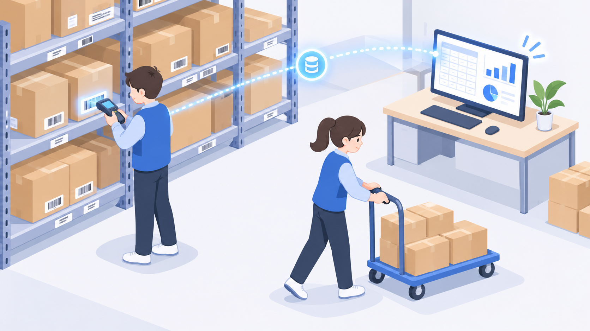

# 시스템을 처음 도입하시는 분들께

EasyWare를 처음 도입하는 단계라면 화면 사용법보다 먼저 아래 내용을 읽어 주세요.

***

1. **WMS(창고관리시스템)는 재고를 정확하게 관리하고, 문제가 생겼을 때 언제·누가·무엇을 했는지 빠르게 추적하기 위해 사용합니다.** \
   그래서 가장 중요한 것은 데이터가 빠짐없이 꾸준하게 쌓이는 것입니다.
2. **시스템을 도입하면 처음에는 일이 줄지 않고 오히려 늘어납니다.** \
   지금까지 하지 않던 "기록"이라는 일이 새로 생기기 때문입니다.
3. **입력은 업무 사이에 짬을 내서 하는 일이 아니라, 그 자체로 하나의 업무입니다.** \
   물건이 움직일 때 데이터도 함께 움직여야 하며, 나중에 몰아서 입력하면 실물과 시스템이 어긋나기 시작합니다.
4. **재고 조회, 작업 지시, 이력 확인 같은 편리함은 데이터가 쌓인 뒤에 따라오는 결과입니다.** \
   처음 한두 달은 번거롭게 느껴질 수 있지만, 기록이 쌓일수록 시스템이 일을 덜어주기 시작합니다.

<figure><figcaption></figcaption></figure>


**물건이 움직일 때 데이터도 함께 움직여야 합니다.**

