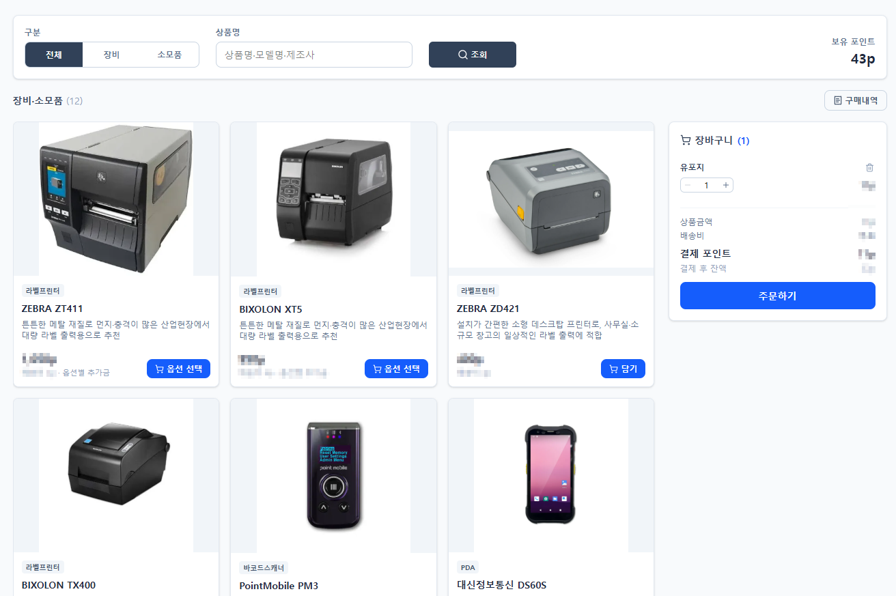

# 장비·소모품 구매

EasyWare에서 쓰는 **장비**(PDA, 바코드 스캐너, 라벨프린터)와 **소모품**(라벨, 리본)을 **포인트로 구매**하는 화면입니다.

| 사용할 수 있는 사람    | 결제 수단                    |
| -------------- | ------------------------ |
| **관리자** 권한 사용자 | 회사 **포인트** (1p = 1,000원) |


* 구매는 **관리자만** 할 수 있습니다.
* 서비스가 **사용 제한** 상태이면 구매할 수 없습니다. ([point.md](../point.md "mention")참고)&#x20;



어떤 장비를 사야 할지 모르겠다면 [undefined.md](undefined.md "mention")를 먼저 읽어 보세요.


<figure><figcaption></figcaption></figure>

***

### 1. 구매 흐름

```
상품 고르기  →  장바구니 담기  →  주문하기 (배송지 입력)  →  포인트 결제  →  구매내역에서 확인
```

***

### 2. 화면 구성

| 영역      | 설명                     |
| ------- | ---------------------- |
| ① 조회 조건 | 구분, 상품명 검색, **보유 포인트** |
| ② 상품 목록 | 판매 중인 상품 카드            |
| ③ 장바구니  | 담은 상품과 결제 금액 (화면 오른쪽)  |

#### 2.1 조회 조건

| 항목     | 설명                                            |
| ------ | --------------------------------------------- |
| 구분     | 상품 종류로 걸러봅니다. **전체**를 누르면 모든 상품이 표시됩니다.       |
| 상품명    | **상품명, 모델명, 제조사**로 검색합니다. `Enter`를 눌러도 검색됩니다. |
| 🔍 조회  | 검색어를 적용하고 상품 정보(가격·품절 여부)를 최신으로 다시 불러옵니다.     |
| 보유 포인트 | 지금 쓸 수 있는 포인트                                 |

#### 2.2 상품 카드

| 표시             | 설명                                           |
| -------------- | -------------------------------------------- |
| 상품 종류          | PDA, 라벨 같은 종류                                |
| **선택 가이드**     | 누르면 장비 선택 가이드가 새 창으로 열립니다.                   |
| 상품명 · 한줄설명     | 상품명을 누르면 **상품 상세**가 열립니다.                    |
| 가격             | 포인트로 표시. 마우스를 올리면 원 금액이 보입니다.                |
| 배송비            | 배송비 또는 **무료배송**. 옵션이 있는 상품은 _옵션별 추가금_ 표시     |
| **담기 / 옵션 선택** | 옵션이 없는 상품은 바로 장바구니에 담고, 옵션이 있는 상품은 상세가 열립니다. |
| 품절             | 품절 상품은 담을 수 없습니다.                            |

***

### 3. 상품 상세

상품명을 누르거나 **옵션 선택**을 누르면 상품 상세 팝업창이 열립니다.

<figure><figcaption></figcaption></figure>

| 영역           | 설명                                                                                     |
| ------------ | -------------------------------------------------------------------------------------- |
| 이미지          | 아래 작은 이미지를 눌러 바꿔 보고, 큰 이미지를 누르면 **확대**됩니다.                                             |
| 제조사 · 모델명    | 상품의 제조사와 모델                                                                            |
| 가격 · 배송비     | 기본 가격과 배송비                                                                             |
| **옵션**       | 사이즈, 수량 단위 등 선택 항목. `*` 표시는 **필수**, _(선택)_ 표시는 고르지 않아도 됩니다. 옵션에 따라 **추가금**이 붙을 수 있습니다. |
| 장비 선택 가이드 보기 | 가이드를 새 창으로 엽니다.                                                                        |
| 수량           | `−` `+` 버튼이나 직접 입력                                                                     |
| **장바구니 담기**  | 옵션을 반영한 금액이 버튼에 표시됩니다.                                                                 |
| 상세 설명        | 이미지 아래에 상품 설명이 표시됩니다.                                                                  |

***

### 4. 장바구니

담은 상품은 화면 오른쪽 **장바구니**에 모입니다.

| 기능      | 설명                                |
| ------- | --------------------------------- |
| 수량 변경   | `−` `+` 버튼이나 직접 입력                |
| 🗑️ 빼기  | 장바구니에서 상품을 뺍니다.                   |
| 상품금액    | 담은 상품 금액의 합                       |
| 배송비     | 아래 4.1 참고                         |
| 결제 포인트  | 상품금액 + 배송비                        |
| 결제 후 잔액 | 결제하고 남는 포인트. 부족하면 **포인트 부족**으로 표시 |

같은 상품이라도 **옵션이 다르면** 장바구니에 따로 담깁니다.

#### 4.1 배송비

여러 상품을 함께 주문하면 배송비는 **가장 큰 배송비 한 번만** 받습니다.

```
예) 라벨프린터(배송비 5p) + 라벨(배송비 3p)을 함께 주문  →  배송비 5p
```


소모품은 장비나 다른 소모품과 **한 번에 주문**하면 배송비를 아낄 수 있습니다.&#x20;


#### 4.2 장바구니가 비워지는 경우

* 장바구니는 **지금 열어둔 브라우저 창에서만** 유지됩니다. 브라우저를 닫으면 비워집니다.
* 담아 둔 상품이 **판매 중단되거나 품절**되면 장바구니에서 자동으로 빠지고 안내가 표시됩니다.

> 판매가 중단되었거나 품절된 상품 N건을 장바구니에서 뺐습니다.

***

### 5. 주문하기

장바구니 아래 **주문하기**를 누르면 주문 팝업창이 열립니다.

<figure><figcaption></figcaption></figure>

#### 5.1 배송지 입력

| 항목      |  필수 | 설명                 |
| ------- | :-: | ------------------ |
| 받는 분    |  ✅  | 받는 사람 이름           |
| 연락처     |  ✅  | 예: 010-0000-0000   |
| 우편번호    |     |                    |
| 주소      |  ✅  |                    |
| 상세주소    |     |                    |
| 배송 요청사항 |     | 예: 부재 시 경비실에 맡겨주세요 |


이전에 주문한 적이 있으면 **직전 주문의 배송지**가 자동으로 채워집니다. (_"직전 주문 배송지를 불러왔습니다"_) 필요하면 고쳐서 주문하세요.


#### 5.2 결제

1. 주문 상품, 상품금액, 배송비, **결제 포인트**를 확인합니다.
2. **보유 포인트**와 **결제 후 잔액**을 확인합니다.
3. **N p 결제하기**를 누릅니다.
4. 확인 창에서 **주문**을 누릅니다.

> 주문하시겠습니까? N p가 차감됩니다.

주문이 완료되면 _"주문이 접수되었습니다. (주문번호)"_ 가 표시되고, 장바구니가 비워지며 **구매내역** 화면으로 이동합니다.

| 상황                           | 안내                                                                 |
| ---------------------------- | ------------------------------------------------------------------ |
| 필수 배송지 누락, 포인트 부족 등          | 안내 메시지가 표시되고 주문되지 않습니다.                                            |
| 주문하는 사이에 **가격이나 배송비가 바뀐** 경우 | _"주문 정보가 변경되었습니다"_ 안내 후 상품 정보를 다시 불러옵니다. 장바구니 금액을 다시 확인하고 주문해 주세요. |


**포인트가 부족하면** 주문할 수 없습니다. [point.md](../point.md "mention")에서 포인트를 충전한 뒤 주문해 주세요.



구매에 쓴 포인트는 [#id-5](../point.md#id-5 "mention")에 기록됩니다.


***

### 6. 구매내역과 취소

구매 화면 오른쪽 위의 [undefined-1.md](../undefined-1.md "mention")에서 주문을 확인할 수 있습니다.

#### 6.1 주문 취소

| 주문 상태           | 취소 방법                          |
| --------------- | ------------------------------ |
| **주문접수**        | 구매내역에서 **직접 취소**할 수 있습니다.      |
| **배송 준비 시작 이후** | 직접 취소할 수 없습니다. 시스템문의로 요청해 주세요. |

취소하면 결제한 포인트를 돌려받으며, 포인트 이력에 기록됩니다.

***

### 7. 자주 묻는 질문 (FAQ)

**Q. 구매 메뉴가 보이지 않아요.** \
구매는 **관리자**만 할 수 있습니다.\
회사 관리자에게 요청해 주세요.

**Q. 어떤 장비를 사야 할지 모르겠어요.** \
[undefined.md](undefined.md "mention")에서 현장 규모와 상황별 추천을 확인해 주세요.

**Q. 담기 버튼 대신 "옵션 선택"이 보여요.** \
사이즈 등 옵션을 골라야 하는 상품입니다. \
눌러서 옵션을 고른 뒤 담아 주세요.

**Q. 장바구니에 담았던 상품이 사라졌어요.** \
브라우저를 닫았거나, 그 상품이 품절·판매 중단된 경우입니다.

**Q. 배송비가 상품마다 붙나요?** \
아니요. 함께 주문하면 가장 큰 배송비 한 번만 받습니다.

**Q. 주문하려는데 "주문 정보가 변경되었습니다"라고 나와요.** \
주문하는 사이 가격이나 배송비가 바뀌었습니다. \
장바구니에서 바뀐 금액을 확인하고 다시 주문해 주세요.

**Q. 주문을 취소하고 싶어요.** \
**주문접수** 상태라면 구매내역에서 직접 취소할 수 있습니다. \
배송 준비가 시작되었다면 시스템문의로 요청해 주세요.

**Q. 카드나 계좌이체로 결제할 수 있나요?** \
구매는 포인트로만 결제합니다. \
먼저 포인트를 충전해 주세요.
