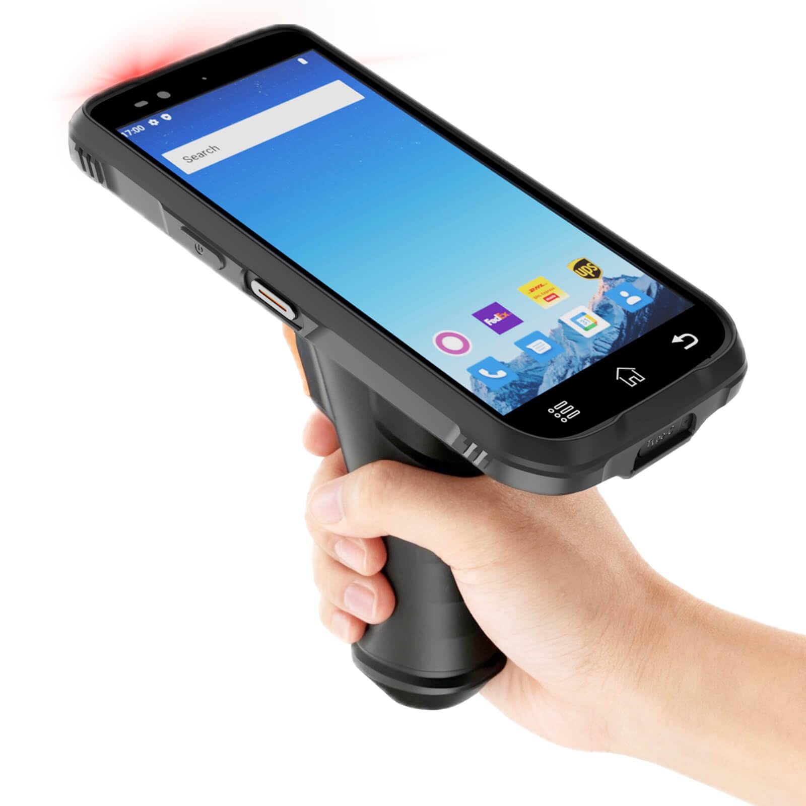

# 장비 소모품 선택 가이드

EasyWare를 현장에서 쓰려면 **바코드를 읽는 스캐너**와 **라벨을 뽑는 프린터**가 필요합니다. 장비를 처음 고르는 분도 쉽게 선택할 수 있도록, 어려운 사양 대신 **어떤 현장에 맞는지**를 중심으로 정리했습니다.

<figure><figcaption></figcaption></figure>

***

### 1. 한눈에 보기

| 구분         | 장비                  | 하는 일                                   |
| ---------- | ------------------- | -------------------------------------- |
| **바코드 읽기** | PDA 또는 블루투스 바코드 스캐너 | 품목·로케이션 바코드를 찍어 입고, 출고, 재고이동, 재고실사를 처리 |
| **라벨 출력**  | 라벨프린터               | 품목 라벨, 로케이션 라벨, 계획 라벨 출력               |
| **소모품**    | 라벨, 리본              | 라벨프린터에 넣어 쓰는 용지와 잉크 역할                 |

#### 규모별 추천 조합

| 현장                            | 바코드 읽기          | 라벨프린터       |
| ----------------------------- | --------------- | ----------- |
| **작은 창고·사무실 겸용** (하루 출고 수십 건) | 블루투스 스캐너 + 스마트폰 | 사무용 (ZD420) |
| **중간 규모 창고** (작업자 여러 명)       | PDA             | 사무용 (ZD420) |
| **물류센터** (하루 출고 수백 건 이상)      | PDA             | 산업용 (ZT411) |


처음이라면 **블루투스 스캐너 + 사무용 프린터 + 아트 라벨**로 시작해 보세요. 비용 부담이 가장 적고, 사용량이 늘면 PDA나 산업용 프린터를 추가하면 됩니다.


***

### 2. 바코드 스캔


EasyWare가 만드는 바코드는 **모두 QR코드**입니다. 그래서 **2D 바코드를 읽을 수 있는 장비**가 필요합니다. 일반 마트용 레이저 스캐너(1D 전용)는 QR코드를 읽지 못합니다.


#### 2.1 PDA vs 블루투스 바코드 스캐너

|        | **PDA**                   | **블루투스 바코드 스캐너**              |
| ------ | ------------------------- | ----------------------------- |
| 한 줄 설명 | **바코드 스캐너가 내장된 산업용 스마트폰** | **내 스마트폰에 연결해서 쓰는 스캐너**       |
| 화면     | 장비에 화면이 있음                | 스마트폰 화면을 사용                   |
| 튼튼함    | 떨어뜨려도 잘 버팀 (방진·방수)        | 스캐너는 튼튼하지만, 스마트폰은 일반 폰        |
| 사용감    | 한 손으로 찍고 바로 처리            | 스캐너와 스마트폰을 함께 들고 작업           |
| 비용     | 높음                        | 낮음                            |
| 추천     | 하루 종일 스캔하는 현장, 작업자 여러 명   | PDA가 부담스러운 소규모 현장, 가끔 스캔하는 경우 |

#### 2.2 PDA

**PDA는 "바코드 스캐너가 내장된 산업용 스마트폰"** 이라고 생각하면 됩니다. 일반 스마트폰처럼 화면을 터치해 EasyWare를 쓰고, 버튼을 누르면 바로 바코드가 찍힙니다.

* 떨어뜨리거나 먼지·물이 튀는 **현장에서도 잘 고장 나지 않습니다.**
* 하루 종일 써도 될 만큼 **배터리가 오래 갑니다.**
* 스캔 속도가 빠르고, 구겨지거나 흐린 바코드도 잘 읽습니다.

**현장용 액세서리**

PDA에 **건트리거**를 끼우면 권총처럼 손잡이를 쥐고 방아쇠를 당겨 스캔할 수 있습니다. 손목 부담이 줄어 **대량 스캔 작업에 편합니다.** 이 밖에도 현장에서 쓰기 편한 액세서리를 함께 제공합니다.

| 추천 대상                    |
| ------------------------ |
| 입고·출고·피킹을 하루 종일 하는 작업자   |
| 여러 작업자가 각자 장비를 들고 다니는 창고 |
| 바닥에 떨어뜨리기 쉬운 거친 현장       |

#### 2.3 블루투스 바코드 스캐너 (PM3)

**가지고 있는 스마트폰에 블루투스로 연결**해서 쓰는 손바닥만 한 스캐너입니다. 스캐너로 바코드를 찍으면 스마트폰의 EasyWare 화면에 바로 입력됩니다.

* **PDA 구매가 부담스러울 때** 가장 경제적인 선택입니다.
* **지금 쓰는 스마트폰**을 그대로 활용할 수 있습니다.
* 작고 가벼워 주머니나 목걸이로 들고 다니기 좋습니다.

| 추천 대상                      |
| -------------------------- |
| PDA 구매가 부담스러운 소규모 창고       |
| 가지고 있는 스마트폰으로 시작해 보고 싶은 경우 |
| 사무실과 창고를 오가며 가끔 스캔하는 경우    |


스마트폰으로 하루 종일 작업하면 배터리가 빨리 닳고, 떨어뜨리면 폰이 파손될 수 있습니다. 작업량이 많아지면 PDA를 고려해 보세요.


***

### 3. 라벨프린터

라벨프린터는 **산업용**과 **사무용(데스크탑)** 으로 나뉩니다. 가장 큰 차이는 **튼튼함**과 **한 번에 얼마나 많이 뽑을 수 있는지**입니다.

|       | **산업용 (예: ZT411)**                | **사무용 (예: ZD420)**        |
| ----- | --------------------------------- | ------------------------- |
| 생김새   | 크고 무거운 금속 본체                      | 책상 위에 올리는 작은 플라스틱 본체      |
| 내구성   | 먼지·충격에 강하고 **하루 종일 쉬지 않고** 돌려도 버팀 | 일반 사무 환경용. 장시간 연속 출력에는 무리 |
| 출력량   | **하루 수천 장** 이상 대량 출력              | 하루 수십\~수백 장               |
| 라벨 교체 | 큰 라벨 롤이 들어가 **교체가 드묾**            | 작은 롤이라 **자주 교체**          |
| 설치 장소 | 물류센터 작업장, 출고 라인                   | 사무실 책상, 작은 창고             |
| 비용    | 높음                                | 낮음                        |

#### 3.1 산업용 프린터 (ZT411)

| 추천 대상                                  |
| -------------------------------------- |
| 출고량이 많아 라벨을 **계속 뽑아야 하는** 물류센터         |
| 먼지가 많거나 사람이 많이 오가는 **작업장 바로 옆**에 두는 경우 |
| 라벨 롤 교체로 작업이 끊기는 게 싫은 현장               |

#### 3.2 사무용 프린터 (ZD420)

| 추천 대상                      |
| -------------------------- |
| 하루 출력량이 많지 않은 **소·중규모 창고** |
| 사무실 책상 위에 두고 필요할 때 뽑는 경우   |
| 처음 시작해서 **비용을 줄이고 싶은** 경우  |


EasyWare에서 출력하는 라벨 크기는 **100×150, 100×50, 50×25, 30×30(mm)** 입니다. 두 프린터 모두 이 크기를 출력할 수 있습니다.


***

### 4. 라벨

라벨은 **아트, 유포, 감열** 세 가지가 있습니다. **어디에, 얼마나 오래 붙여 둘지**로 고르면 됩니다.

|         | **아트**            | **유포**               | **감열**                  |
| ------- | ----------------- | -------------------- | ----------------------- |
| 한 줄 설명  | 가장 기본적인 **종이 라벨** | **찢어지지 않는** 합성 라벨    | **리본 없이** 뽑는 라벨         |
| 가격      | 가장 저렴             | 비쌈                   | 저렴                      |
| 리본      | 필요                | 필요                   | **필요 없음**               |
| 물·습기    | 약함                | **강함**               | 보통                      |
| 찢어짐     | 잘 찢어짐             | **안 찢어짐**            | 잘 찢어짐                   |
| 햇빛·열    | 괜찮음               | 괜찮음                  | **약함** (변색되어 안 읽힐 수 있음) |
| 오래 붙여두기 | 보통                | **가장 오래감**           | 짧음                      |
| 추천      | 일반 박스·품목 라벨       | 로케이션 라벨, 냉장·냉동, 습한 곳 | 금방 쓰고 버리는 출고·택배 라벨      |

#### 4.1 아트 라벨

**가장 기본적인 저가형 종이 라벨**입니다. 실내에서 쓰는 일반 품목·박스 라벨에 적합합니다.

#### 4.2 유포 라벨

플라스틱 성분이 들어간 합성지라 **잘 찢어지지 않고 물에 강합니다.** 랙에 오래 붙여두는 **로케이션 라벨**이나, 습기가 많은 **냉장·냉동 창고**에 추천합니다.

#### 4.3 감열 라벨

열을 가하면 색이 변하는 종이라 **리본(먹지)이 필요 없습니다.** 대신 **직사광선이나 열에 약해** 시간이 지나면 글자가 흐려지거나 검게 변할 수 있습니다. 출고 박스처럼 **짧게 쓰고 버리는 라벨**에 적합하고, 오래 붙여둘 로케이션 라벨에는 맞지 않습니다.


감열 라벨을 창가나 햇빛이 드는 곳, 뜨거운 곳에 두면 바코드 인식률이 저하될 수 있습니다.


***

### 5. 리본

리본은 **아트·유포 라벨에 글자를 찍는 잉크 필름(먹지)** 입니다. **감열 라벨에는 필요 없습니다.** 리본은 **라벨 종류에 맞춰** 고르면 됩니다.

|          | **왁스**         | **왁스레진**              | **레진**                    |
| -------- | -------------- | --------------------- | ------------------------- |
| 함께 쓰는 라벨 | **아트**         | 아트, 유포                | **유포**                    |
| 긁힘·문지름   | 약함             | 보통                    | **강함**                    |
| 물·습기     | 약함             | 보통                    | **강함**                    |
| 가격       | 가장 저렴          | 보통                    | 비쌈                        |
| 추천       | 일반 실내 품목·박스 라벨 | 손을 많이 타는 라벨, 아트·유포 겸용 | 로케이션 라벨, 냉장·냉동, 오래 붙여둘 라벨 |

#### 라벨 + 리본 추천 조합

| 용도                | 라벨 | 리본    |
| ----------------- | -- | ----- |
| 일반 품목·박스 라벨       | 아트 | 왁스    |
| 자주 손이 닿는 품목 라벨    | 아트 | 왁스레진  |
| 랙에 오래 붙여둘 로케이션 라벨 | 유포 | 레진    |
| 냉장·냉동·습한 창고       | 유포 | 레진    |
| 금방 버리는 출고·택배 라벨   | 감열 | 필요 없음 |


**라벨과 리본의 짝이 맞지 않으면** 글자가 번지거나 쉽게 지워집니다. 특히 유포 라벨에 왁스 리본을 쓰면 잘 찍히지 않으니 주의하세요.


***

### 6. 상황별 추천

| 이런 상황이라면                   | 추천                                  |
| -------------------------- | ----------------------------------- |
| 일단 저렴하게 시작해 보고 싶어요         | 블루투스 스캐너 + 사무용 프린터 + 아트 라벨 + 왁스 리본  |
| 작업자 3\~4명이 동시에 스캔해요        | 작업자마다 PDA (대량 스캔이면 건트리거 추가)         |
| 하루 출고가 수백 건이에요             | PDA + 산업용 프린터                       |
| 로케이션 라벨을 한 번 붙이고 오래 쓰고 싶어요 | 유포 라벨 + 레진 리본                       |
| 냉장·냉동 창고예요                 | 유포 라벨 + 레진 리본                       |
| 리본 갈아 끼우는 게 번거로워요          | 감열 라벨 (단, 햇빛·열 주의, 오래 붙여둘 라벨에는 부적합) |

***

### 7. 구매하기

[.](./ "mention")를 참고하세요.

***

### 8. 자주 묻는 질문 (FAQ)

**Q. 지금 쓰는 바코드 스캐너가 있는데 써도 되나요?** \
**QR코드(2D)를 읽을 수 있는 스캐너**라면 사용할 수 있습니다. \
마트용 레이저 스캐너처럼 1D 바코드만 읽는 제품은 EasyWare 바코드를 읽지 못합니다.

**Q. PDA와 블루투스 스캐너 중 무엇을 사야 할지 모르겠어요.** \
하루 종일 스캔한다면 **PDA**, 가끔 스캔하거나 비용이 부담된다면 **블루투스 스캐너**를 추천합니다.

**Q. 사무용 프린터로도 충분한가요?** \
하루 출력량이 수십\~수백 장이라면 충분합니다. \
하루 종일 쉬지 않고 출력해야 하는 현장이라면 산업용을 추천합니다.

**Q. 라벨이 금방 흐려져요.** \
**감열 라벨**을 햇빛이나 열이 있는 곳에 두면 흐려집니다. \
오래 붙여둘 라벨은 아트나 유포 라벨로 바꿔 주세요.

**Q. 로케이션 라벨이 자꾸 찢어지거나 떨어져요.** \
**유포 라벨 + 레진 리본** 조합을 추천합니다.

**Q. 감열 라벨에도 리본이 필요한가요?** \
아니요. 감열 라벨은 리본 없이 출력합니다.

**Q. 리본은 아무거나 써도 되나요?** \
라벨에 맞춰야 합니다. \
아트는 **왁스**, 유포는 **레진**이 기본이고, **왁스레진**은 두 라벨 모두에 쓸 수 있습니다.
