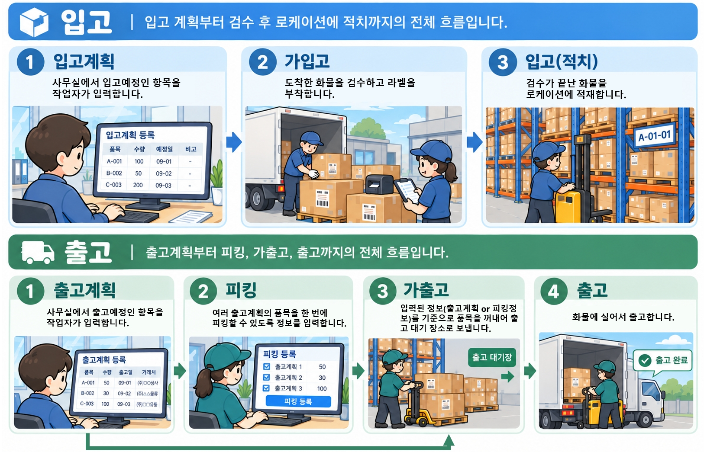

# 전반적인 시스템 흐름

EasyWare가 제공하는 핵심 기능을 한눈에 정리했습니다. \
각 기능의 자세한 사용법은 각페이지에서 확인하실 수 있습니다.

### 1. 입고부터 출고까지, 단계별로 관리

<figure><figcaption></figcaption></figure>

물건이 들어와서 나가기까지의 과정을 단계별로 나눠서 관리합니다. 각 단계마다 지금 어디까지 진행됐는지 상태로 확인할 수 있습니다.

| 단계                                                                      | 하는 일                       | 재고 변화      |
| ----------------------------------------------------------------------- | -------------------------- | ---------- |
| [plan.md](../inbound/plan.md "mention")                                 | 들어올 물건의 예정 내용을 등록          | 변화 없음      |
| [pre-inbound.md](../inbound/pre-inbound.md "mention")                   | 도착한 화물을 내리면서 라벨을 붙이고 검수    | 입고존에 재고 반영 |
| [putaway.md](../inbound/putaway.md "mention")                           | 검수가 끝난 물건을 보관 위치(로케이션)에 보관 | 입고존 → 로케이션 |
| [plan.md](../plan.md "mention")                                         | 나갈 물건의 예정 내용을 등록           | 변화 없음      |
| [picking.md](../picking.md "mention")                                   | 여러 출고계획의 품목을 한 번에 모아서 꺼내기  | 변화 없음      |
| [pre-outbound.md](../pre-outbound.md "mention")                         | 로케이션에서 물건을 꺼내 출고 대기 장소로 이동 | 로케이션 → 출고존 |
| [출고](https://app.gitbook.com/s/Pd5zp2Co7sL6fXg6Xfh6/outbound "mention") | 출고 대기 중인 물건을 싣고 실제로 내보냄    | 재고 차감      |

가입고와 가출고는 한 번에 다 처리하지 않고 나눠서(분할) 등록할 수도 있습니다. 가출고는 출고계획 또는 피킹을 통해 등록할 수 있습니다.

### 2. 재고를 한눈에 확인

* [stock.md](../stock/stock.md "mention"): 품목 기준, 로케이션(보관 위치) 기준으로 현재 재고를 조회합니다. 품목이나 로케이션을 누르면 LOT와 입고일별 상세 재고까지 펼쳐서 볼 수 있습니다.
* [history.md](../stock/history.md "mention"): 언제, 어떤 물건이 얼마나 들어오고 나갔는지 내역을 조회합니다.

### 3. 바코드로 빠르고 정확하게

품목과 로케이션 바코드를 스캔해서 입력하기 때문에 오타나 품목 착오를 줄일 수 있습니다. PC뿐 아니라 PDA와 모바일 환경에서도 사용할 수 있습니다.

### 4. 품목마다 다른 관리 방식 지원

| 관리 방식        | 설명                                                          |
| ------------ | ----------------------------------------------------------- |
| LOT 관리       | LOT 번호를 기준으로 재고를 구분하여 입출고                                   |
| 선입선출         | 먼저 들어온 재고부터 출고. 더 오래된 재고가 남아 있으면 경고로 알려 주고, 확인 후 진행할 수 있습니다 |
| 시리얼번호(SN) 관리 | 제품 하나하나에 번호를 부여하여 입출고와 위치 이동 이력을 추적                         |

### 5. 재고를 맞추고 마감하기

* [move.md](../stock/move.md "mention"): 로케이션 사이의 재고를 옮깁니다. 창고 간 이동도 가능합니다.
* [etc-in-out.md](../stock/etc-in-out.md "mention"): 입출고 계획과 관계없이 발생한 재고 변동을 사유와 함께 기록합니다.
* [count.md](../stock/count.md "mention"): 로케이션 단위로 실제 재고를 세어서, 시스템 재고와의 차이를 반영합니다. 여러 명이 구역을 나누어 실사할 수 있습니다.
* [close.md](../stock/close.md "mention"): 월 단위로 창고별 재고를 기록해 둡니다. 마지막으로 마감한 달까지는 재고를 변경할 수 없습니다. <mark style="background-color:$info;">3개월 넘게 마감하지 않으면 재고수불부에 재고수량이 표시되지 않습니다.</mark>

### 6. SN 이력 조회와 관리

SN 관리 품목은 [sn-history.md](../stock/sn-history.md "mention")에서 번호별 입출고 이력을 조회하고, [sn-manage.md](../stock/sn-manage.md "mention")에서 현재 보유 중인 SN을 확인하거나 잘못 등록된 SN을 정정할 수 있습니다.

### 7. 사용자와 문의 관리

사용 중 문제나 요청 사항은 [system-inquiry.md](../support/system-inquiry.md "mention")로 바로 전달할 수 있습니다.
