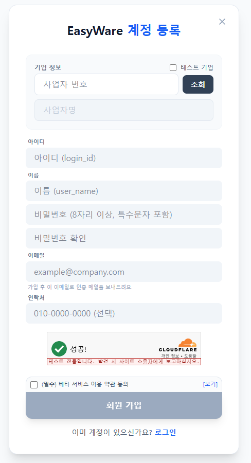
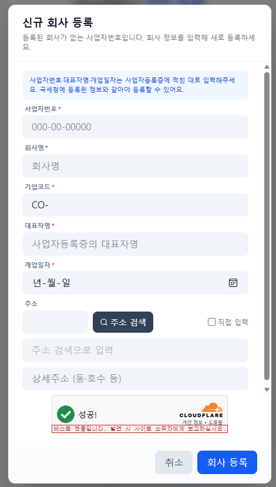
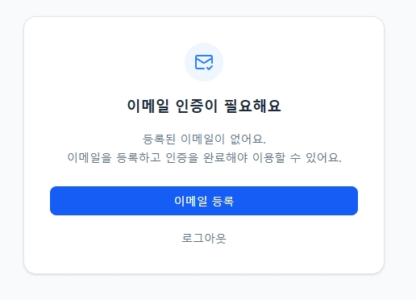
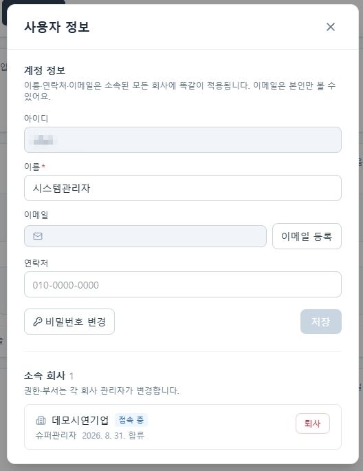
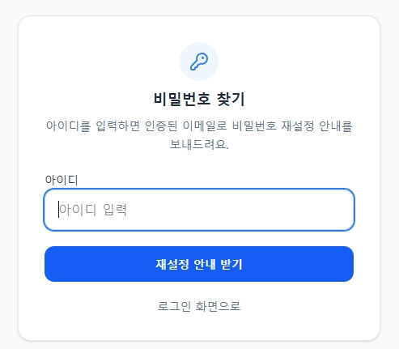
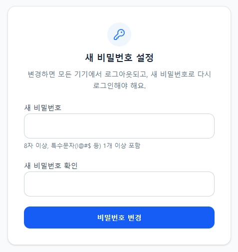

# 계정과 회사구조 이해하기


EasyWare를 처음 사용할 때 알아두면 좋은 **계정, 회사, 권한의 관계**를 설명합니다.

<figure><figcaption></figcaption></figure>

***

### 1. 한눈에 보기

```
            ┌───────────── 계정 (로그인 아이디 1개) ─────────────┐
            │                                                    │
       A 회사 소속                                          B 회사 소속
       권한: 관리자                                        권한: 일반사용자
            │                                                    │
     A 회사의 창고·품목·재고                           B 회사의 창고·품목·재고
```

| 개념     | 설명                                             |
| ------ | ---------------------------------------------- |
| **계정** | 로그인할 때 쓰는 아이디. 사람 한 명당 하나면 충분합니다.              |
| **회사** | 창고, 품목, 재고 같은 업무 데이터의 주인. 사업자번호로 구분합니다.        |
| **소속** | 계정이 어느 회사에서 일하는지. **한 계정이 여러 회사에 소속**될 수 있습니다. |
| **권한** | 그 회사에서 무엇을 할 수 있는지. **회사마다 따로** 정해집니다.         |


**핵심 정리**

* 회원가입할 때 **기업 정보(사업자번호)를 반드시 입력**합니다.
* 회원가입할 때 **이메일을 반드시 입력**하고, 가입 후 **이메일 인증**을 마쳐야 업무 기능을 사용할 수 있습니다.
* 한 사용자는 **여러 회사에 소속**될 수 있습니다.
* 회사를 **처음 등록한 사용자는 관리자**가 됩니다.
* 이미 등록된 회사에 가입하는 사용자는 **권한대기** 상태가 되고, 관리자가 권한을 줘야 업무를 할 수 있습니다.


***

### 2. 회원가입

<figure><figcaption></figcaption></figure>

#### 2.1 기업 정보 확인

회원가입 화면 맨 위의 **기업 정보**에서 소속 회사를 먼저 확인합니다. 회사 없이 계정만 만들 수는 없습니다.

1. **사업자 번호** 10자리를 입력하고 **조회**(또는 `Enter`)를 누릅니다.
2. 결과에 따라 다음과 같이 진행합니다.

| 조회 결과          | 진행 방법                                                                                  | 가입 후 내 권한                             |
| -------------- | -------------------------------------------------------------------------------------- | ------------------------------------- |
| **이미 등록된 회사**  | 사업자명이 표시되고 _"✓ 기업 정보 확인됨"_ 으로 바뀝니다. 그대로 가입을 진행합니다.                                     | **권한대기** — 관리자가 권한을 줄 때까지 업무 기능 사용 불가 |
| **등록되지 않은 회사** | _"등록되지 않은 사업자 번호입니다."_ 옆의 **신규 회사 등록**을 눌러 회사 정보를 입력합니다. 등록되면 _"✓ 신규 회사 등록됨"_ 으로 바뀝니다. | **관리자** — 바로 모든 기능 사용 가능              |

#### 신규 회사 등록

**신규 회사 등록**을 누르면 회사 정보를 입력하는 팝업창이 열립니다.

<figure><figcaption></figcaption></figure>

| 항목    |  필수 | 설명                                              |
| ----- | :-: | ----------------------------------------------- |
| 사업자번호 |  ✅  | 조회했던 번호가 `000-00-00000` 형식으로 미리 채워집니다.          |
| 회사명   |  ✅  | 회사 이름                                           |
| 기업코드  |  ✅  | 회사를 구분하는 코드. 사업자번호를 바탕으로 **자동 추천**되며 바꿀 수 있습니다. |
| 대표자명  |  ✅  | **사업자등록증에 적힌 대표자명** 그대로 입력합니다.                  |
| 개업일자  |  ✅  | **사업자등록증에 적힌 개업일자**를 날짜로 선택합니다. 오늘 이후 날짜는 고를 수 없습니다. |
| 주소    |     | 선택                                              |


**사업자 진위확인**: 회사를 등록할 때 입력한 **사업자번호·대표자명·개업일자가 국세청에 등록된 정보와 같은지** 확인합니다. 세 가지 모두 **사업자등록증에 적힌 대로** 입력해 주세요. 사업자번호 10자리를 다 입력했는데 번호 형식이 맞지 않으면 입력칸 아래에 _"사업자번호를 다시 확인해주세요."_ 안내가 표시됩니다.


1. 항목을 입력합니다.
2. 팝업창 아래의 **자동 등록 방지 확인**을 완료합니다. (확인이 끝나야 **회사 등록** 버튼이 켜집니다.)
3. **회사 등록**을 누릅니다.

회사가 만들어지면 회원가입 화면의 기업 정보가 _"✓ 신규 회사 등록됨"_ 으로 바뀝니다. 등록할 수 없으면 **"회사를 등록할 수 없습니다"** 경고창에 사유가 표시됩니다.

| 안내 메시지                                     | 의미 / 해결 방법                                    |
| ------------------------------------------ | --------------------------------------------- |
| 입력한 사업자 정보가 국세청 등록 정보와 일치하지 않아요.            | 사업자번호·대표자명·개업일자를 사업자등록증과 다시 비교해 주세요.          |
| 올바른 사업자번호가 아니에요.                           | 사업자번호를 잘못 입력했습니다.                             |
| 국세청에 등록되지 않은 사업자번호예요.                      | 번호를 다시 확인해 주세요.                               |
| 폐업한 사업자는 회사로 등록할 수 없어요.                     | 폐업한 사업자번호는 등록할 수 없습니다. (휴업 중인 사업자는 등록할 수 있습니다.) |
| 이미 등록된 사업자번호 / 기업코드                         | 이미 등록된 회사입니다. 사업자번호로 조회해 그 회사에 합류하세요.         |
| 지금은 사업자 정보를 확인할 수 없어요. / 지금은 회사를 등록할 수 없어요. | 일시적인 문제입니다. 잠시 후 다시 시도해 주세요.                   |
| 요청이 많아요. 잠시 후 다시 시도해주세요.                    | 짧은 시간에 등록·조회를 너무 많이 시도했습니다. 잠시 후 다시 시도해 주세요.  |


회사는 **회사 등록**을 누르는 순간 만들어집니다. 회원가입을 끝내야 그 회사의 첫 사용자(관리자)가 됩니다.


```
사업자번호 조회
   │
   ├─ 등록된 회사 ────────▶ 기업 정보 확인됨 ──▶ 가입 ──▶ 권한대기 ──(관리자 승인)──▶ 업무 시작
   │
   └─ 등록되지 않은 회사 ─▶ 신규 회사 등록 ────▶ 가입 ──▶ 관리자로 바로 시작
```


* 기업 정보가 확인되면 사업자번호를 수정할 수 없습니다. 바꾸려면 **재입력**을 누르세요.
* 사업자번호를 조회하지 않고 가입하면 _"사업자 번호를 조회 하여 기업정보를 확인해 주세요"_ 안내가 표시됩니다.
* 시스템을 미리 써보려면 **테스트 기업**을 체크하세요. (아래 7. 데모 시연 기업 참고)


#### 2.2 계정 정보 입력

| 항목      |  필수 | 설명                                |
| ------- | :-: | --------------------------------- |
| 아이디     |  ✅  | 로그인 아이디. 이미 사용 중인 아이디면 안내가 표시됩니다. |
| 이름      |  ✅  | 사용자 이름                            |
| 비밀번호    |  ✅  | **8자 이상**, **특수문자(!@#$ 등) 1개 이상**  |
| 비밀번호 확인 |  ✅  | 비밀번호와 같게 입력. 일치하면 _"✓ 일치합니다."_    |
| 이메일     |  ✅  | 예: `example@company.com`. **가입 후 이 이메일로 인증 메일**을 보냅니다. 비밀번호를 잊었을 때도 이 이메일로 안내를 받습니다. |
| 연락처     |     | 선택 (예: 010-0000-0000)             |


* 이메일은 **실제로 메일을 받을 수 있는 주소**를 입력하세요. 인증을 마치지 않으면 업무 기능을 사용할 수 없습니다.
* `withdrawn_`으로 시작하는 아이디는 사용할 수 없습니다. (_"사용할 수 없는 아이디예요."_)


#### 2.3 약관 동의 및 가입

1. **자동 가입 방지 확인**을 완료합니다. (확인이 끝나기 전에는 _"자동 가입 방지 확인을 완료해주세요."_ 가 표시되고 **회원 가입** 버튼이 꺼져 있습니다.)
2. **(필수) 베타 서비스 이용 약관 동의**를 체크합니다. \*\*\[보기]\*\*로 내용을 확인할 수 있습니다.
3. **회원 가입**을 누릅니다.
4. 가입 완료 메시지가 나오면 로그인 화면으로 이동합니다.

| 가입 완료 메시지                                                         | 다음 할 일                                     |
| ----------------------------------------------------------------- | ------------------------------------------ |
| 회원가입이 완료되었어요. 입력한 이메일로 인증 메일을 보냈어요.                              | 메일함에서 인증 메일의 링크를 눌러 인증을 완료합니다. (아래 2.4 참고) |
| 회원가입이 완료되었어요. 지금은 인증 메일을 보낼 수 없어요.                               | 로그인한 뒤 **인증 메일 다시 보내기**를 누릅니다.             |


현재는 **베타 서비스**입니다. 시스템 개선을 위해 데이터가 초기화될 수 있으며, 이 경우 최소 3일 전에 공지합니다.



같은 아이디로 로그인을 **5번 이상 실패**하면 자동입력 방지 확인이 추가로 나타납니다.


#### 2.4 이메일 인증

가입할 때 입력한 이메일로 **\[EasyWare] 이메일 인증을 완료해주세요** 메일이 발송됩니다.

1. 메일함에서 인증 메일을 열고 **링크**를 누릅니다. (메일이 보이지 않으면 스팸함도 확인하세요.)
2. _"이메일 인증이 완료되었어요."_ 화면이 나오면 **로그인 화면으로**를 눌러 로그인합니다.

인증 링크는 **24시간** 동안 한 번만 사용할 수 있습니다. 링크가 만료되었거나 이미 사용했다면 _"인증하지 못했어요"_ 화면이 나오니, 로그인한 뒤 인증 메일을 다시 받으세요.

**인증하지 않고 로그인하면** 업무 화면 대신 **"이메일 인증이 필요해요"** 안내가 표시됩니다.

<figure><figcaption></figcaption></figure>

등록된 이메일이 없으면 **이메일 등록**과 **로그아웃** 버튼만 표시됩니다. 이메일이 있으면 아래 버튼이 표시됩니다.

| 버튼              | 설명                                                                 |
| --------------- | ------------------------------------------------------------------ |
| **인증 완료했어요**    | 메일의 링크로 인증한 뒤 누르면 업무 화면으로 들어갑니다. 아직이면 _"아직 인증이 완료되지 않았어요."_ 안내가 나옵니다. |
| **인증 메일 다시 보내기** | 인증 메일을 다시 보냅니다. 이전에 받은 링크는 더 이상 쓸 수 없습니다.                        |
| **이메일 수정**      | 가입할 때 이메일을 잘못 입력했다면 올바른 주소로 바꾸고 인증 메일을 다시 받습니다. (현재 비밀번호 필요)     |
| **로그아웃**        | 로그인 화면으로 돌아갑니다.                                                    |


* 다른 탭에서 메일 링크로 인증한 뒤 이 화면으로 돌아오면 **자동으로 다시 확인**합니다.
* 인증 메일은 **1분에 한 번**만 다시 보낼 수 있고, 하루에 보낼 수 있는 횟수도 정해져 있습니다. _"인증 메일을 방금 보냈어요. 1분 뒤에 다시 시도해주세요."_ 또는 _"인증 메일 요청이 많아…"_ 안내가 나오면 잠시 후 다시 시도하세요.
* 이메일 인증은 **권한대기보다 먼저** 확인합니다. 이미 등록된 회사에 합류했다면 이메일 인증을 마친 뒤 관리자의 권한 지정을 기다립니다.


#### 2.5 직원을 회사에 합류시키려면

1. 관리자가 직원에게 **회사 사업자번호**를 알려줍니다.
2. 직원이 그 사업자번호로 회원가입합니다. (이미 계정이 있다면 **회사 추가**, 아래 4.1 참고)
3. 관리자가 사용자관리에서 **승인 대기** 버튼을 눌러 직원에게 권한을 줍니다.


사용자관리에서 직원 계정을 직접 만들 수는 없습니다. 직원이 직접 가입하고, 관리자는 **승인(권한 지정)** 만 합니다.


***

### 3. 권한

권한은 **회사마다 따로** 정해집니다. 같은 사람이 A 회사에서는 관리자, B 회사에서는 일반사용자일 수 있습니다.

| 권한        | 할 수 있는 일                                               |
| --------- | ------------------------------------------------------ |
| **관리자**   | 모든 메뉴 사용. 직원 승인·권한 변경·퇴사처리(사용자관리), 포인트와 자동결제 관리(포인트관리) |
| **일반사용자** | 관리자 전용 메뉴를 제외한 업무 메뉴 사용                                |
| **권한대기**  | 업무 기능을 **사용할 수 없음**. 관리자가 권한을 줄 때까지 기다리는 상태            |


회사에는 **관리자가 최소 1명** 있어야 합니다. 관리자를 다른 사람에게 넘기려면 **새 관리자를 먼저 지정한 뒤** 본인 권한을 바꿔 주세요.


***

### 4. 여러 회사에서 사용하기

한 계정으로 여러 회사의 업무를 볼 수 있습니다. 예를 들어 여러 화주사의 창고를 함께 관리하는 경우입니다.

#### 4.1 다른 회사에 합류하기 (회사 추가)

이미 계정이 있다면 새로 가입하지 않고 **회사 추가**로 다른 회사에 합류합니다. 회원가입과 같은 **기업 정보** 확인 화면이 열립니다.

* 이미 등록된 회사라면 **권한대기**로 합류하고, 그 회사 관리자가 권한을 줍니다.
* 등록되지 않은 회사라면 **신규 회사 등록** 후 **관리자**가 됩니다.

<figure><figcaption></figcaption></figure>

<figure><figcaption></figcaption></figure>

#### 4.2 로그인할 때 회사 고르기

| 소속 회사     | 로그인하면                     |
| --------- | ------------------------- |
| **1개**    | 바로 그 회사로 들어갑니다.           |
| **2개 이상** | 들어갈 **회사를 선택**한 뒤 로그인합니다. |

<figure><figcaption></figcaption></figure>

#### 4.3 로그인한 뒤 회사 바꾸기

소속 회사가 2개 이상이면 화면 오른쪽 위에 **현재 회사명**이 표시됩니다. 눌러서 다른 회사로 바꿀 수 있습니다.

#### 4.4 회사마다 완전히 분리됩니다

로그인한 회사의 데이터만 보입니다. A 회사로 로그인했을 때 B 회사의 창고, 품목, 재고, 사용자 정보는 보이지 않습니다.

***

### 5. 내 정보 관리 (사용자 정보)

화면 오른쪽 위 **내 이름(프로필) > 사용자 정보**에서 다음을 할 수 있습니다.

<figure><figcaption></figcaption></figure>

* 이름·연락처 수정 (소속된 **모든 회사에 똑같이** 적용)
* 이메일 등록·변경 (인증 메일의 링크를 눌러야 반영)
* **비밀번호 변경**
* 소속 회사와 회사별 권한·부서 확인
* 회사 나가기 (**마지막 소속 회사에서 나가면 계정도 함께 탈퇴**됩니다)
* **계정 탈퇴** (모든 소속 회사에서 한 번에 나가고 계정을 삭제)

자세한 사용법은 [undefined.md](../company/user/undefined.md "mention")를 참고하세요.

#### 5.1 비밀번호를 잊었을 때 (비밀번호 찾기)

로그인 화면의 비밀번호 입력칸 오른쪽 위 **비밀번호 찾기**를 누릅니다.

<figure><figcaption></figcaption></figure>

1. **아이디**를 입력하고 **재설정 안내 받기**를 누릅니다.
2. _"안내를 보냈어요"_ 화면이 나오면 메일함에서 **\[EasyWare] 비밀번호 재설정 안내** 메일을 엽니다.
3. 메일의 링크를 누르면 **새 비밀번호 설정** 화면이 열립니다.
4. **새 비밀번호**와 **새 비밀번호 확인**을 입력하고 **비밀번호 변경**을 누릅니다.
5. _"비밀번호를 변경했어요. 새 비밀번호로 로그인해주세요."_ 가 나오면 새 비밀번호로 로그인합니다.

<figure><figcaption></figcaption></figure>


* 재설정 안내는 **이메일 인증을 마친 계정**에만 보내집니다. 이메일 인증을 하지 않았다면 메일이 오지 않으니 회사 관리자나 [시스템 문의](../support/system-inquiry.md)로 연락해 주세요.
* 아이디가 없거나 이메일이 인증되지 않았어도 화면에는 같은 안내가 표시됩니다. (다른 사람이 가입 여부를 알 수 없도록 하기 위해서입니다.)
* 메일의 링크는 **30분** 동안 **한 번만** 사용할 수 있습니다. 다시 요청하면 이전 링크는 쓸 수 없습니다.



* 새 비밀번호를 설정하기 전까지는 **기존 비밀번호로 계속 로그인**할 수 있습니다.
* 비밀번호를 바꾸면 **모든 기기에서 로그아웃**되고, 인증된 이메일로 **\[EasyWare] 비밀번호가 변경되었어요** 알림 메일이 갑니다.
* 짧은 시간에 여러 번 요청하면 **보안 확인**이 나타나거나 _"요청이 많아요. 잠시 후 다시 시도해주세요."_ 안내가 표시됩니다.
* 관리자가 사용자관리에서 **재설정 메일**을 보내 줄 수도 있습니다. ([user](../company/user/ "mention") 참고)


***

### 6. 회사를 떠날 때

회사에서 나가는 방법은 세 가지입니다.

| 방법         | 하는 사람                                                        | 되돌리기                                              |
| ---------- | ------------------------------------------------------------ | ------------------------------------------------- |
| **퇴사처리**   | 관리자가 [user](../company/user/ "mention")에서                    | 관리자가 **복직처리**로 되돌릴 수 있습니다.                        |
| **회사 나가기** | 본인이 [undefined.md](../company/user/undefined.md "mention")에서 | 복직처리할 수 없습니다. 다시 합류하려면 **회사 추가** 후 관리자 승인이 필요합니다. |
| **계정 탈퇴**  | 본인이 [undefined.md](../company/user/undefined.md "mention")에서 | **되돌릴 수 없습니다.** 모든 소속 회사에서 나가고 계정이 삭제됩니다. 다시 사용하려면 새로 회원가입해야 합니다. |

회사를 떠나면 이렇게 됩니다.

* 그 회사에 **더 이상 접속할 수 없고**, 그 회사의 이력도 볼 수 없습니다.
* 그 사람이 등록한 입출고 등의 **기록은 회사에 그대로 남습니다.** (누가 처리했는지 확인할 수 있어야 하기 때문입니다.)
* **다른 회사의 소속에는 영향이 없습니다.**


직원이 퇴사하면 관리자가 **바로 퇴사처리**해 주세요. 퇴사처리를 하지 않으면 퇴사한 직원이 계속 회사 데이터에 접속할 수 있습니다.


***

### 7. 데모 시연 기업

실제 회사를 등록하기 전에 시스템을 미리 써보고 싶다면 **데모 시연 기업**으로 가입하세요.

1. 회원가입 화면의 기업 정보에서 **테스트 기업**을 체크합니다.
2. 데모 시연 기업이 자동으로 조회되어 _"✓ 기업 정보 확인됨"_ 으로 바뀝니다.
3. 나머지 정보를 입력하고 가입합니다.

| 항목    | 데모 시연 기업에서는                                     |
| ----- | ----------------------------------------------- |
| 권한    | 가입하면 바로 **관리자** 권한으로 사용할 수 있습니다.                |
| 사용자관리 | 여러 사람이 함께 쓰는 공용 회사라 **본인 정보만** 조회되고 수정할 수 없습니다. |
| 시스템문의 | 다른 사용자에게 보이지 않도록 항상 **나만보기**로 등록됩니다.            |
| 포인트   | 과금 대상이 아닙니다.                                    |


데모 시연 기업은 여러 사람이 함께 사용합니다. **실제 업무 데이터나 개인정보는 입력하지 마세요.** 실제로 사용하려면 내 회사의 사업자번호로 **회사 추가**를 해 주세요. 데모 시연 기업은 나중에 **회사 나가기**로 정리할 수 있습니다.


***

### 8. 새 회사가 만들어지면

새 회사가 등록될 때 업무를 바로 시작할 수 있도록 기본 설정이 **자동으로 준비**됩니다.

| 자동 준비 항목          | 설명                                   |
| ----------------- | ------------------------------------ |
| 가상 창고 · 입고존 · 출고존 | 입고와 출고 과정에서 재고가 잠시 머무는 구역 (창고 관리 참고) |
| 기본 공통코드           | 입출고 상태, 입고·출고 유형 등 (공통코드 관리 참고)      |
| 기본 권한             | 관리자, 일반사용자, 권한대기                     |

#### 처음 시작하는 관리자를 위한 순서

```
① 창고 등록  →  ② 로케이션 등록  →  ③ 카테고리·품목 등록  →  ④ 거래처 등록
   →  ⑤ 직원 합류·권한 지정  →  ⑥ 포인트 충전  →  업무 시작
```

| 순서 | 할 일                             | 매뉴얼     |
| -- | ------------------------------- | ------- |
| ①  | 실제 창고를 등록합니다.                   | 창고 관리   |
| ②  | 창고 안의 보관 위치를 만듭니다.              | 로케이션 관리 |
| ③  | 카테고리를 만들고 품목을 등록합니다.            | 품목관리    |
| ④  | 매입처와 매출처를 등록합니다.                | 거래처 관리  |
| ⑤  | 직원에게 사업자번호를 알려주고, 가입하면 권한을 줍니다. | 사용자관리   |
| ⑥  | 월사용료를 낼 포인트를 충전합니다.             | 포인트관리   |

***

### 9. 자주 묻는 질문 (FAQ)

**Q. 가입했는데 아무 메뉴도 쓸 수 없어요.** \
_"이메일 인증이 필요해요"_ 안내가 보이면 인증 메일의 링크를 눌러 **이메일 인증**을 먼저 완료하세요. \
인증 후에도 쓸 수 없다면 이미 등록된 회사에 합류해서 **권한대기** 상태입니다. \
회사 관리자에게 권한을 요청해 주세요.

**Q. 인증 메일이 오지 않아요.** \
스팸함을 확인하고, 그래도 없으면 로그인 후 **인증 메일 다시 보내기**를 누르세요. \
이메일을 잘못 입력했다면 **이메일 수정**으로 올바른 주소를 입력하세요.

**Q. 비밀번호를 잊어버렸어요.** \
로그인 화면의 **비밀번호 찾기**에서 아이디를 입력하면 인증된 이메일로 재설정 안내를 보내드립니다. \
이메일 인증을 하지 않은 계정은 회사 관리자나 시스템 문의로 연락해 주세요.

**Q. 우리 회사 관리자가 누군지 모르겠어요.** \
회사를 처음 등록한 사람이 관리자입니다. \
회사 내부에 확인해 주세요.

**Q. 회사마다 계정을 따로 만들어야 하나요?** \
아니요. 계정 하나로 **회사 추가**를 하면 여러 회사에서 사용할 수 있습니다.

**Q. 다른 소속 회사로 바꾸려면 어떻게 하나요?** \
소속 회사가 2개 이상이면 화면 오른쪽 위 회사명을 눌러 다른 회사로 바꿀 수 있습니다. \
로그인할 때 회사를 고를 수도 있습니다.

**Q. 직원 계정을 관리자가 만들어 줄 수 있나요?** \
아니요. 직원이 회사 사업자번호로 직접 가입하고, 관리자는 권한만 지정합니다.

**Q. 이름이나 연락처를 바꾸고 싶어요.** \
프로필 메뉴의 **사용자 정보**에서 수정하세요. \
소속된 모든 회사에 똑같이 적용됩니다. 이메일은 **이메일 변경**으로 인증 메일을 받아 바꿉니다.

**Q. 내 권한이나 부서를 바꾸고 싶어요.** \
권한과 부서는 그 회사의 **관리자**만 바꿀 수 있습니다. \
관리자에게 요청해 주세요.

**Q. 회사에서 나갔다가 다시 들어가고 싶어요.** \
**회사 추가**로 다시 합류하세요. \
합류하면 권한대기 상태가 되고, 관리자가 권한을 줘야 합니다.

**Q. 탈퇴하고 싶어요.** \
사용자 정보 맨 아래의 **계정 탈퇴**를 누르세요. 모든 소속 회사에서 한 번에 나가고 계정이 삭제됩니다. \
한 회사만 그만두려면 계정 탈퇴 대신 그 회사만 **회사 나가기** 하세요.

**Q. 데모 시연 기업으로 써보다가 실제로 쓰고 싶어요.** \
**회사 추가**로 내 회사의 사업자번호를 등록하세요. \
데모 시연 기업에 입력한 데이터는 옮겨지지 않습니다.

**Q. 사업자번호를 잘못 입력해서 엉뚱한 회사에 합류했어요.** \
먼저 올바른 사업자번호로 **회사 추가**를 한 뒤, 사용자 정보에서 잘못 합류한 회사를 **회사 나가기** 하세요. \
순서를 반대로 하면 그 회사가 유일한 소속일 때 계정이 탈퇴 처리됩니다.
