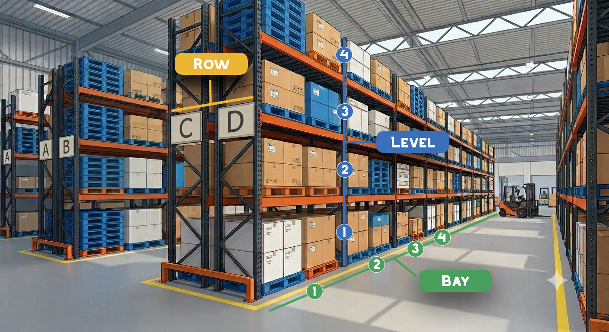

# 로케이션관리

창고 안에서 재고를 보관하는 **위치(로케이션)** 를 등록하고 관리하는 화면입니다. 입고, 출고, 재고 이동 등 재고가 움직이는 모든 작업은 로케이션을 기준으로 이루어집니다.

<figure><figcaption></figcaption></figure>

***

### 1. 로케이션 코드 체계

로케이션은 랙(선반)의 위치를 **Row → Bay → Level** 순서로 표현합니다.

| 구분        | 의미              | 예시                     |
| --------- | --------------- | ---------------------- |
| **Row**   | 통로별 열 구분        | A, B, C … 또는 1, 2, 3 … |
| **Bay**   | 수직 기둥 사이의 공간(칸) | 1, 2, 3 …              |
| **Level** | 수직으로 쌓이는 층(단)   | 1, 2, 3 …              |

```
예시: A-1-3  →  A열 · 1번 칸 · 3단
```







***

### 2. 화면 구성

#### 2.1 상단 툴바

| 버튼/요소      | 위치  | 설명                                        |
| ---------- | --- | ----------------------------------------- |
| 창고 선택      | 왼쪽  | 조회할 창고를 선택합니다. (기본값: 전체 창고)               |
| 검색창        | 왼쪽  | 로케이션 코드 또는 명칭을 입력합니다. `Enter`를 눌러도 조회됩니다. |
| 🔍 조회      | 왼쪽  | 조건에 맞는 로케이션을 조회합니다.                       |
| 🖨️ 바코드 출력 | 오른쪽 | 선택한 로케이션의 바코드를 출력합니다.                     |
| 📄 일괄추가    | 오른쪽 | Row/Bay/Level 조합으로 로케이션을 한 번에 생성합니다.      |
| ➕ 버튼       | 오른쪽 | 로케이션 행을 하나 추가합니다.                         |
| **행 복제** | 오른쪽 | 마지막으로 클릭한 행을 바로 아래에 복사합니다. 단축키는 목록에서 `Ctrl + Shift + Enter`입니다. |
| 💾 저장      | 오른쪽 | 추가/수정한 내용을 저장합니다.                         |

#### 2.2 로케이션 목록 컬럼

| 컬럼      | 설명                                       |  수정 |
| ------- | ---------------------------------------- | :-: |
| ☑ (선택)  | 바코드 출력 대상 선택. 머리글의 체크박스로 현재 페이지 전체 선택/해제 |  ✅  |
| 창고      | 로케이션이 속한 창고 (드롭다운 선택)                    |  ✅  |
| 로케이션 코드 | 로케이션을 구분하는 코드 (예: `A-1-3`)               |  ✅  |
| 명칭      | 로케이션 이름                                  |  ✅  |
| Row     | 열                                        |  ✅  |
| Bay     | 칸                                        |  ✅  |
| Level   | 단                                        |  ✅  |
| 유형      | 로케이션 유형                                  |  ✅  |
| 사용 여부   | 사용 / 미사용                                 |  ✅  |
| 생성일     | 로케이션이 등록된 일시                             |  —  |
| 수정일     | 마지막으로 수정된 일시                             |  —  |

#### 2.3 하단 페이지 이동 영역

| 요소                     | 설명                                       |
| ---------------------- | ---------------------------------------- |
| `«` `‹` 페이지 번호 `›` `»` | 처음 / 이전 / 해당 페이지 / 다음 / 마지막 페이지로 이동      |
| 표시 개수                  | 한 페이지에 표시할 개수 선택 (20 / 50 / 100 / 150개씩) |
| 총 N건                   | 조회 조건에 해당하는 전체 로케이션 수                    |

***

### 3. 로케이션 조회

1. 필요하면 **창고**를 선택합니다. (전체 창고를 대상으로 하려면 그대로 둡니다.)
2. 검색창에 로케이션 코드 또는 명칭을 입력합니다.
3. **조회** 버튼을 누르거나 `Enter`를 누릅니다.

***

### 4. 로케이션 추가

로케이션은 두 가지 방법으로 추가할 수 있습니다.

| 방법        | 언제 사용하나요?                              |
| --------- | -------------------------------------- |
| **일괄 생성** | 랙을 새로 설치하는 등 로케이션을 한 번에 여러 개 만들 때 (권장) |
| **개별 추가** | 특수 위치(입고 대기장, 불량품 보관소 등)처럼 하나씩 따로 만들 때 |

#### 4.1 일괄 생성

Row × Bay × Level의 모든 조합으로 로케이션을 자동 생성합니다.

1. 툴바의 **📄 일괄추가** 버튼을 클릭합니다.
2. **창고**를 선택합니다.
3. Row, Bay, Level별로 **수량**과 **시작값**을 입력합니다.
4. **로케이션 생성**을 클릭합니다.

<figure><figcaption></figcaption></figure>

| 설정    | 항목  | 설명                                      | 기본값 |
| ----- | --- | --------------------------------------- | --- |
| Row   | 수량  | 만들 열의 개수                                | 1   |
|       | 시작값 | 첫 번째 열의 값                               | A   |
|       | 타입  | **알파벳**(A, B, C …) 또는 **숫자**(1, 2, 3 …) | 알파벳 |
| Bay   | 수량  | 열마다 만들 칸의 개수                            | 1   |
|       | 시작값 | 첫 번째 칸 번호                               | 1   |
| Level | 수량  | 칸마다 만들 단의 개수                            | 1   |
|       | 시작값 | 첫 번째 단 번호                               | 1   |

**생성 예시**

| Row        | Bay        | Level      | 생성되는 로케이션                                                                                      |
| ---------- | ---------- | ---------- | ---------------------------------------------------------------------------------------------- |
| 수량 2, 시작 A | 수량 3, 시작 1 | 수량 2, 시작 1 | A-1-1, A-1-2, A-2-1, A-2-2, A-3-1, A-3-2, B-1-1, B-1-2, B-2-1, B-2-2, B-3-1, B-3-2 (총 **12개**) |


생성되는 로케이션 수 = **Row 수량 × Bay 수량 × Level 수량**


생성이 끝나면 결과가 표시되고 목록이 새로고침됩니다.

> 생성 완료! (신규: N건, 제외: N건)


* **이미 존재하는 로케이션 코드는 제외**하고 생성됩니다. 같은 조건으로 다시 생성해도 중복으로 만들어지지 않습니다.
* 알파벳 타입에서는 시작값이 자동으로 대문자로 바뀝니다.
* 팝업의 **로케이션 체계 옆 `?`** 를 누르면 Row/Bay/Level 구조 그림을 볼 수 있습니다.



* 수량은 **1 이상**이어야 합니다.
* 시작값은 비워둘 수 없습니다.


#### 4.2 개별 추가

1. 툴바의 **➕ 버튼**을 클릭합니다.
2. 목록 맨 아래에 새 행이 추가되고, **로케이션 코드 칸이 바로 입력 상태**가 됩니다.
3. **창고**를 선택하고 로케이션 코드, 명칭 등을 입력합니다.
4. 💾 **저장**을 클릭합니다.


개별 추가 시에는 로케이션 코드가 자동으로 만들어지지 않습니다. **창고**와 **로케이션 코드**를 반드시 입력해 주세요.


#### 행 복제

비슷한 행을 여러 개 등록할 때는 복사할 행을 클릭하고 툴바의 **행 복제**를 누르세요. (단축키: 로케이션 목록에서 `Ctrl + Shift + Enter`) 클릭한 행 바로 아래에 새 행이 추가됩니다.


창고·로케이션명·구역·열·연·단이 복사되며, **로케이션 코드는 새로 입력**해야 합니다. 입고존·출고존 로케이션은 복제할 수 없습니다. 복제한 행도 💾 **저장**해야 등록됩니다.


***

### 5. 로케이션 수정

| 컬럼                                    | 수정 방법           |
| ------------------------------------- | --------------- |
| 창고                                    | 셀의 드롭다운에서 선택    |
| 로케이션 코드 / 명칭 / Row / Bay / Level / 유형 | 셀을 더블클릭하여 직접 입력 |
| 사용 여부                                 | 체크박스 클릭         |

수정한 뒤에는 반드시 **💾 저장**을 눌러야 반영됩니다.


**시스템용 가상 창고**에 속한 로케이션은 사용 여부를 변경할 수 없습니다. (체크박스가 잠겨 있습니다.)


***

### 6. 저장

저장 버튼을 누르면 **새로 추가된 행**과 **수정된 행**만 골라서 한 번에 저장합니다. 저장이 끝나면 목록을 다시 불러오고, 다음과 같은 메시지가 표시됩니다.

> 저장 완료 (신규: N, 수정: N)

| 상황                      | 안내 메시지         |
| ----------------------- | -------------- |
| 변경 사항이 없음               | 변경된 데이터가 없습니다. |
| 저장 실패 (필수값 누락, 중복 코드 등) | 저장 실패          |


저장하지 않은 상태에서 **조회, 페이지 이동, 표시 개수 변경, 일괄 생성**을 하면 입력한 내용이 사라집니다. 반드시 저장 후 진행하세요.


***

### 7. 바코드 출력

랙에 부착할 로케이션 바코드를 출력합니다.

1. 목록 왼쪽의 **☑ 체크박스**로 출력할 로케이션을 선택합니다.
   * 머리글의 체크박스를 누르면 **현재 페이지**의 로케이션이 모두 선택됩니다.
2. 툴바의 **🖨️ 바코드 출력**을 클릭합니다.
3. **로케이션 라벨 출력** 창에서 라벨 형식을 고르고 **출력**을 누릅니다. 새 탭에 출력 화면이 열립니다.

> 📷 **[이미지]** '로케이션 라벨 출력' 창 (라벨 100×50 / 50×25 / 30×30 형식 선택이 보이도록)

| 라벨 형식      | 내용                      |
| ---------- | ----------------------- |
| 라벨 100×50  | 로케이션코드, 명칭, 창고, 열·연·단     |
| 라벨 50×25   | 로케이션코드와 명칭              |
| 라벨 30×30   | QR과 로케이션명               |


* 선택한 로케이션이 없으면 _"출력할 로케이션을 선택해주세요."_ 메시지가 표시됩니다. 한 번에 최대 100건까지 출력할 수 있습니다.
* 여러 페이지에 걸쳐 출력하려면 표시 개수를 늘린 뒤 선택하세요. 페이지를 이동하면 선택이 해제됩니다.


***

### 8. 로케이션 삭제 대신 "미사용" 처리

저장된 로케이션은 목록에서 삭제할 수 없습니다. 더 이상 사용하지 않는 로케이션은 **사용 여부 체크를 해제**한 뒤 저장하세요.

***

### 9. 자주 묻는 질문 (FAQ)

**Q. 랙을 새로 설치했어요. 로케이션을 하나씩 만들어야 하나요?** \
**일괄추가**를 사용하세요. \
Row/Bay/Level 수량만 입력하면 모든 조합이 한 번에 생성됩니다.

**Q. 기존 랙에 칸을 몇 개 더 늘렸어요.** \
늘린 범위를 포함해서 일괄 생성을 다시 실행해도 됩니다. \
이미 있는 로케이션은 제외되고 **새로운 로케이션만** 생성됩니다.

**Q. Row를 숫자로 만들고 싶어요.** \
일괄 생성 팝업의 Row 설정에서 **타입**을 **숫자**로 바꿔 주세요. \
시작값이 `1`로 바뀝니다.

**Q. 사용 여부 체크박스가 눌리지 않아요.** \
시스템용 가상 창고에 속한 로케이션입니다. \
이 로케이션은 사용 여부를 변경할 수 없습니다.

**Q. 행을 잘못 추가했어요. 어떻게 지우나요?** \
저장하기 전이라면 **조회** 버튼을 눌러 목록을 다시 불러오면 추가한 행이 사라집니다. \
(단, 저장하지 않은 다른 수정 내용도 함께 사라집니다.)

**Q. 로케이션을 삭제하고 싶어요.** \
저장된 로케이션은 삭제되지 않습니다. \
**사용 여부를 해제**하여 미사용 처리해 주세요.

***

### 10. 키 조작 요약

| 키       | 위치     | 동작    |
| ------- | ------ | ----- |
| `Enter` | 검색창    | 조회    |
| `Enter` | 셀 편집 중 | 편집 확정 |
| `Esc`   | 셀 편집 중 | 편집 취소 |
| `Ctrl + Shift + Enter` | 로케이션 목록 | 마지막으로 클릭한 행 복제 |
